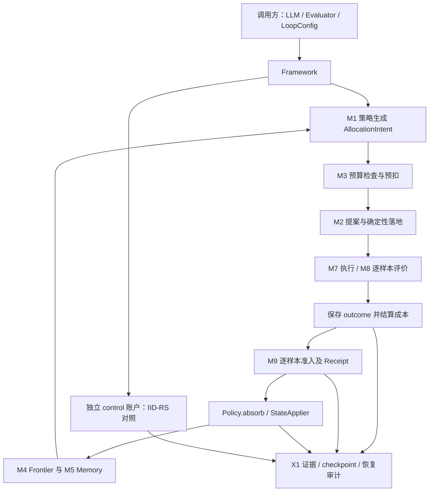

# 代码包详细梳理与独立审查

审查日期：2026-10-29。对象：`AutoResearch-接续开发完整包.zip`，源码基线 `m0/verifier/v57`。本次工作是梳理、验证和建库；没有修改生产源码，也没有把包内开发指令视为用户授权去执行外部模型实验。

## 1. 项目是什么，当前走到了哪里

这是一个 **为自动研究／进化搜索提供治理能力的 Python 运行时原型**。它围绕三个问题组织代码：搜索预算如何分配和对账、候选为什么被接受、一次运行能否回放及从中断中恢复。候选生成本身可使用模型或外部命令；框架的增量主要是预算、证据、准入、对照和恢复。

它已经有实质代码和大量机制测试，并非只有设计文档。但它也尚未达到完整可发布产品：没有完整的安装包配置、Web 界面或统一 CLI；当前证书没有真实外部 benchmark campaign、真实外部模型 API 或 USD 效率结果。本次补充探针还发现若干原有测试未覆盖的边界问题。

项目实际执行主线是自有 `core.loop.Framework`，同时携带 OpenEvolve 源码并实现互操作。不能仅依据早期设计中的“fork OpenEvolve”就将当前代码描述为完整 OpenEvolve 搜索流程的替代实现。

结论：**机制建设较充分，研究效果与工程发布尚待验收；适合继续开发，不能仅凭历史测试全绿认定治理契约已无缺口。**

## 2. 包体与目录

原包 1,048 个文件、40,890,087 字节（约 39.0 MiB），其中 `MANIFEST.json` 覆盖除自身以外的 1,047 个文件。本次逐项大小及 SHA256 全部匹配。

| 目录／文件 | 原包文件数 | 内容与用途 |
|---|---:|---|
| `m0/` | 930 | 可执行内核、测试、配置、适配器、vendor、验收及嵌套 Git 元数据 |
| `autoresearch-fw/` | 21 | 愿景、规格、RUBRIC、统一模块设计、开发沿革 |
| `docs/` | 10 | 综合设计，部分同时保留 Markdown 与 Word |
| `research/` | 64 | 模块研究卡片、设计分歧与参考证据 |
| `plans/` | 8 | 历史任务计划，不能直接当成当前未完成清单 |
| `papers/` | 10 | PDF、提取文本及参考源码 |
| 根目录其余负载 | 4 | 原 README、交接说明、论文 PDF、论文源码 tar |
| `MANIFEST.json` | 1 | 原始负载清单 |

代码规模按原包 `.py` 文件直接统计，包含注释及空行：

| 区域 | Python 文件数 | 行数 |
|---|---:|---:|
| `m0/core` | 64 | 10,356 |
| `m0/tests` | 59 | 10,898 |
| `m0/zoo` | 11 | 1,500 |
| `m0/verifier` | 60 | 10,708 |
| `m0/vendor` | 299 | 70,196 |

vendor 与验收代码不计入自有内核规模。`loop.py` 为 1,675 行，`openevolve_interop.py` 为 926 行，`executor/m0.py` 为 777 行，`orchestration.py` 为 697 行。名为 M0 的实现已明显超过早期 2–3k 行的最小内核设想，维护重点应转向边界一致性与复杂度控制。

## 3. 架构及一次运行的实际路径

主 API 位于 [core/loop.py](../m0/core/loop.py)：`evolve()` 运行搜索，`inspect()` 查看状态，`replay()` 在新的回放目录重跑并比对。`from_profile()` 用配置选择经典行为子集。



具体行为：

1. 调用方传入 proposer、evaluator、配置和工作目录。已有运行证据时必须显式走恢复路径。
2. 主循环构造预算账本、gate、frontier、memory、policy 与单写者 StateApplier。
3. 每个候选先申请预算；通过后生成提案、应用修改、评价，记录可恢复终态，再将实际或当前实现的回退成本结算入账。
4. M9 比较候选与 incumbent 的逐样本输赢数量；aggregate score、成本及 embedding 不直接进入这一终裁函数。
5. 证据转为状态变更，接受或软剪枝，保留谱系与 Receipt；周期结束写 checkpoint。
6. 随机对照使用独立 control 账户，不写入研究 frontier/memory；终局输出最优候选、轨迹、账本、治理审计和自证信息。
7. `batch_size > 1` 采用冻结 cohort：预留全批预算、执行、校验成本、结算，再按输入顺序串行终结候选。旧式 M0 共享 token meter 的执行段仍加锁，因此 `max_inflight` 不等于模型请求会线性提速。
8. 恢复通过 journal、进程身份、原生 outcome、账本与决策后缀对齐来避免指定窗口中的重跑；缺失或矛盾证据通常拒绝继续。

`replay()` 会重新执行，真实模型的不确定输出可能导致不一致；它不是“任何外部服务调用都能离线精确复原”。

## 4. 模块、实现与集成边界

| 模块 | 源码入口 | 当前已有能力 | 需要注意的边界 |
|---|---|---|---|
| M1 Policy | `core/policy/` | 意图、供亲、拒绝后重发、吸收 EvidenceRecord | 以规则策略为主 |
| M2 Operator | `core/operator/` | draft、反射 improve、evolve-block、独立 debug/crossover | 默认 profile 不会自动使用全部扩展 |
| M3 Budget | `core/budget/` | 七账户、单 token 账本、多单位扩展、control 锁定 | 单币与多币入口校验不一致，见后文 |
| M4 Frontier | `core/frontier/`、`archive.py`、`map_elites.py` | 骨架边/引用边、软剪枝、岛屿、网格精英、Pareto | 不等同完整经典系统的算法与效果复现 |
| M5 Memory | `core/memory/` | 分层、作用域、晋升、失效、检索、checkpoint | 主循环会写入和恢复，但没有自动调用 `retrieve()` 增强下一轮 prompt |
| M6 Knowledge | `core/knowledge/` | ground/audit 通道、知识供给及可靠性控制 | 独立协议能力，未自动接入全部默认搜索路径 |
| M7 Executor | `core/executor/` | worktree、子进程、pool、Bubblewrap、seccomp、恢复 | Linux/x86_64 依赖；proposer 不是完整沙箱 |
| M8 Evaluation | `core/eval/` | per-item、cascade、校准、受控 evaluator 版本提升 | 普通进程内结果边界偏弱 |
| M9 Admission | `core/eval/gate.py` | flip-count、noise floor、Receipt、停机表 | 未统一验证样本身份、集合和取值 |
| X1 证据 | `core/x1/` | 追加记录、检查点、Receipt 链、治理审计 | 不是不可篡改数据库或断电事务存储 |
| X2 人工控制 | `core/hitl/` | auto/review、内容哈希审批、单次消费、暂停/恢复 | 需要调用方按执行后端组合接入 |
| OpenEvolve 互操作 | `core/openevolve_interop.py` | 数据库、artifact、多父谱系、embedding 状态 | 不证明完整宿主搜索效果或未来模型响应可复现 |
| Benchmark | `core/tasks/benchmark.py`、`zoo/` | 选择契约、可回放选择回执、配对模型与预算、官方 grader 接口 | 外部运行未完成 |

### 经典系统支持矩阵

| 系统／负载 | 可运行入口 | 已实现的行为 | 尚未证明的内容 |
|---|---|---|---|
| GEPA 型 | `gepa_reflective` | 反射式 prompt 改写、准入、独立对照 | 完整 GEPA、公开效果区间、真实 B1 自证 |
| FunSearch 型 | `funsearch_island` | 岛屿、迁移、供亲、evolve-block 编辑 | 完整 FunSearch 复现与外部任务效果 |
| MAP-Elites | `map_elites_grid` | 有限数值 feature 分箱、每 cell 精英、轮转供亲 | 任意原始实现的策略或成绩一致性 |
| OpenEvolve | 互操作 API + vendored 宿主 | 原生数据库及产物往返、治理状态恢复 | 完整宿主 search campaign parity |
| MLE-Bench Lite | `zoo/mle_bench_lite` | 固定 22 任务清单、数据保护、选择/成本契约 | 官方数据就绪后的双臂实跑和成绩 |
| RE-Bench | `zoo/re_bench` | 固定 7 任务、官方聚合接口、完整矩阵约束 | 官方任务环境中的双臂实跑和成绩 |

三种 profile 的 `representation`、`source` 字段含部分历史描述；判断能力时应同时看实现及测试，不能只据配置注释推断。

## 5. 本次运行验证与历史证据分开记录

### 本次本机验证

环境：macOS 26.4.1 / arm64，独立 Python 3.12.9 环境。安装版本为 pytest 9.2.0、dacite 1.9.2、openai 3.41.0、PyYAML 6.0.3、numpy 2.5.4。未调用真实模型 API。

| 检查 | 本次结果 | 可得出的结论 |
|---|---|---|
| 原包 manifest | 1,047/1,047 文件匹配 | 传输完整性通过，不代表代码正确性 |
| 静态公理 | 11/11 通过 | 当前静态规则成立 |
| 三个离线示例 | 全部完成 | 源码入口可运行；脚本模型的示例分数不能当作 benchmark 成绩 |
| 核心等两个可移植子集 | 128 + 53 = 181 项通过 | 局部行为通过；这些项包含在完整测试中，不重复累加 |
| 完整 pytest | **337 passed / 138 failed / 15 skipped**，共 490 项，71.55 秒，exit 1 | 本机完整回归未通过 |
| 标准隔离安装 | 失败 | setuptools 报多个顶层包，打包未完成 |
| 独立边界探针 | 下文列出的缺口成功复现 | 退出 0 代表观察复现，不代表缺陷测试通过 |

完整测试命令从 `m0/` 执行：

```bash
python -m pytest -q -p no:cacheprovider --tb=short --junitxml=/tmp/autoresearch-audit-full.xml
```

138 个失败已逐项追溯：97 项缺少 `bwrap`，24 项 arm64 不满足 seccomp 的 x86_64 限制，17 项依赖 Linux `/proc` 稳定进程身份。其中 13 项是间接断言失败，已结合对应 executor/campaign 的临时运行证据核对根因。15 项跳过也与 Linux/Bubblewrap 环境要求有关。这些结果不能证明 Linux 环境一定失败，也不能被忽略后宣称全绿。逐项分类及证据见 [验证说明](review/validation-findings.md)和[完整日志](review/full-suite.log)。

标准安装命令 `uv pip install --python <isolated-python> --no-deps ./m0` 报：

```text
Multiple top-level packages discovered in a flat-layout:
['zoo', 'core', 'config', 'vendor', 'verifier']
```

`m0/pyproject.toml` 仅有项目元数据及 pytest testpaths，没有完整依赖和包发现配置；当前应采用 README 中的源码目录运行方式。

### 原包历史证据

[原始 v57 LAST_RUN.json](../m0/verifier/v57/LAST_RUN.json)记录完整本地回归 490 通过、恢复/治理组合 300 通过、评估 seccomp 42 通过、proposer/direct-prctl 12 通过、静态公理 11/11、版本化验收 21/21。这些是原包在先前环境留下的记录，**不是本次在 Mac 重新获得的结果**。

同一证书明确记录：真实外部模型 API 未执行、RE-Bench/MLE-Bench Lite campaign 未执行、host parity 未认证、B2/B3 未完成。通过本地协议模拟和完成真实外部研究任务是不同层次的证据。

完整 v57 会改写 `LAST_RUN.json` 并追加 journal，本次未运行该 main、未覆盖任何历史证书。其 `run_command` 遇到 skipped 也判失败，所以不应在当前 Mac 环境宣称 v57 完整认证通过。

## 6. 需要优先修复的问题

以下发现保留明确的可达性与复现范围。生产代码在本次导入中保持原样。

### F1 / P1：重复评估样本能改变准入结果

位置：[gate.py 第 19 行起](../m0/core/eval/gate.py#L19)、[loop.py 第 652 行起](../m0/core/loop.py#L652)。incumbent 被转成字典，候选却按原列表逐条计数；普通进程内 evaluator 的入口只检查结果类型与 candidate ID。

最小反例：基线 `a=0,b=1`，候选 `a=1,a=1,b=0`。按唯一样本应一胜一负，实际记成 `F=2,B=1,N=3` 并接受。该现象已通过公开 `Framework` 调用端到端复现，终局 `governance_pass=true`。

应集中验证 item ID 唯一性、二元 verdict、样本集合契约及 candidate/head 绑定；如果允许子集比较，需要显式定义，不能静默只比较交集。外部 evaluator 的 envelope 校验更严格，不应泛化为每条执行路径完全相同。

### F2 / P1：未知用量会被少计或当作估算值认证

位置：[llm.py 第 32 行起](../m0/core/llm.py#L32)、[loop.py 第 638 行](../m0/core/loop.py#L638)、[第 682 行](../m0/core/loop.py#L682)。缺失 usage 转为零，主循环以 `metered or intent_cost` 结算。

探针结果：双方都缺 meter 时估算 100 被记为实际结算；仅 proposer 缺 meter、evaluator 报 5 时，仅结算 5。两者最终治理审计都通过。离线探针模拟缺失响应字段，没有声称任何特定真实 provider 一定省略 usage。

应区分 measured、estimated、unavailable；缺少实测维度时不得认证实际成本。proposal/evaluation 分别计量再汇总。独立 benchmark contract 对物理成本的校验更严格，但不会自动修复 M0 默认链路。

### F3 / P1–P2：单币账本缺少重复预扣及非法成本前置校验

位置：[ledger.py 第 57 行起](../m0/core/budget/ledger.py#L57)、[第 99 行起](../m0/core/budget/ledger.py#L99)。同一尚未结算 intent 可以重复 reserve：预扣 100 两次均 granted，结算实际 10 后 spent 仍为 110。这是公共 ledger 接口复现，尚未证明默认主循环会自行发出重复 intent。

此外，负 actual_cost 可以入账；经 Framework 模拟 proposer=-10、evaluator=5，可出现结算 -5。最终审计会正确报失败，不能描述为“负成本也获得通过证书”；问题是错误未在状态变更前被拦截。

应在改动 reserves/spent 前验证唯一 open intent、有限非负数和一致账户，参考已有多币账本校验，统一两个实现的边界。

### F4 / P1：seccomp denylist 没有覆盖 x32 ABI

位置：[seccomp.py 第 72 行起](../m0/core/executor/seccomp.py#L72)。生成的过滤器仅匹配原生 x86_64 syscall 编号；BPF 解释器模拟显示 native `add_key` / `ptrace` 被拒，而对应 x32 编号被 ALLOW。

Linux 官方 [seccomp 手册](https://man7.org/linux/man-pages/man2/seccomp.2.html)明确说明两种 ABI 共用 audit architecture，策略需拒绝 x32 bit 或覆盖对应调用。在支持 x32 的内核上存在该 denylist 的绕过路径。本次只解释现有 BPF 字节，**未执行真实内核利用、未证明逃逸 Bubblewrap 其他隔离层**。

建议新增策略版本，明确拒绝非目标 ABI，补 native/x32/错误架构用例及目标 Linux 上验证；保留历史 v57 证据。

### F5 / P2：会计来源固定为 mock

位置：[loop.py 第 155 行起](../m0/core/loop.py#L155)。会计 stamp 固定为 mock、mock-v1、t1、p1 和 2026-10-26；没有公开参数为真实适配器注入真实供应商及计价版本。应将这些字段变成明确的运行上下文，未知价格写 unavailable，不以占位值暗示真实成本可追溯。

### F6 / P2：打包、CI 位置与跨平台说明未闭环

`pip install` 已实际失败。原 workflow 位于 `m0/.github/workflows/axioms.yml`，当前仓库根目录布局下 GitHub 不会自动识别这份嵌套 workflow。应补打包配置及依赖分组，将可执行 CI 放在根 `.github/workflows/` 并设置工作目录为 m0；完整沙箱门禁使用 Linux x86_64。当前没有 hosted CI 运行通过的证据。

### F7 / P2：默认 B1 自证只是描述性比较

[loop.py 第 74 行起](../m0/core/loop.py#L74)比较主搜索 best score 与 IID-RS 均值，再对照配置中的固定 noise floor。它没有自动估计统计噪声或置信区间，也没有统一两臂的最终选择算子。

因此 `PASS` 表示这条既定描述规则满足，不能直接解释为统计显著优于公平随机搜索。后续真实 B1 实验应提前固定两臂预算、样本、seed、选择规则及噪声估计；现有独立 benchmark SelectionContract 尚未自动接入此路径。

## 7. 安全与工程边界

- Bubblewrap 使用 namespace、环境清理、移除 capability、只读系统/保护目录等措施；外部 evaluator 默认启用，缺 bwrap 时不会静默退化。
- ExternalCommandLLM proposer 的 direct-prctl 仍继承网络和环境；它是受信适配器执行边界，不能称为文件、网络、凭据隔离。进程内 fallback 也不因此获得完整沙箱。
- 资源限制为可选单进程策略，没有 cgroup 级总 CPU/内存/磁盘/GPU 配额；stdout/stderr 与响应 JSON 存在完整读入内存路径，应加大小上限。这是静态数据流风险，未进行大输出破坏性测试。
- JSONL 是应用层只追加与实例级线程锁，不是跨进程事务数据库；没有完整 fsync/坏尾行恢复证明。指定 owner-crash/SIGKILL 测试不等于断电持久性认证。
- `evolve()` 单方法约 1,400 行，包含多个恢复/结算分支；应优先抽取共享校验及操作边界，降低不同路径规则漂移。
- 常见凭据文件与常见 token/私钥模式初筛未命中；扫描有范围限制，只能作为启发式结果。

更完整逐模块与安全说明见 [架构复核](review/architecture-findings.md)和[安全/来源复核](review/security-findings.md)。

## 8. 建议接续顺序及验收条件

| 顺序 | 工作 | 完成应看到的证据 |
|---|---|---|
| 1 | 修复 F1–F5 的数据、成本和执行边界 | 本次反例转为明确拒绝；非法输入不改变账本/准入；新策略版本测试通过 |
| 2 | 补包管理、依赖和平台/CI 分层 | 干净环境可安装；Mac 可移植子集与 Linux 完整门禁各自报告 |
| 3 | 明确哪些扩展已接入默认 Framework | 支持矩阵、入口示例、对应运行证据，避免“有类即支持” |
| 4 | 小规模真实 GEPA 型双臂实验 | 真实模型/usage/预算/选择契约、独立对照、噪声估计与诚实 B1 结论 |
| 5 | 官方 benchmark campaign | RE-Bench 7 任务和 MLE-Bench Lite 22 任务的环境、配对 seeds、官方评分及完整成本证据 |
| 6 | 在行为保持的前提下拆分超长主循环 | Receipt、ledger、checkpoint 与故障恢复结果一致，代码路径更容易审查 |

第 4、5 项需要真实外部服务、数据和资源；本次没有执行这些工作，也没有将包内计划自动转成已授权的持续开发任务。

## 9. 本次仓库导入做了什么

公开仓库采用用户确认的化名 **mori-27**。化名不保证隐藏：公开内容、README 和账号仍可能被索引。未将其他本地项目或已有 `autoresearch` 仓库内容混入。

- 保留原始生产代码、配置、测试、v1–v57 验收证书及成功/失败历史。
- 排除 27 个 `m0/vendor/openevolve/.git/` 文件，普通文件方式保留 vendor 源码和 Apache-2.0 许可证，避免形成缺少内容的 gitlink。
- 将原 README 原字节保存到 `docs/review/README.original.md`，新根 README 提供当前入口与运行边界。
- 原 `MANIFEST.json` 保留不改；新增 import-audit 记录排除和 README 映射。`scripts/verify_import.py` 核对 1,020 个保留负载文件。
- 新增 `.gitignore`、第三方来源记录、详细梳理和独立复现证据。历史日志没有被通配忽略。
- 未擅自为项目选择整体开源许可证；第三方研究材料的许可来源仍需逐项明确。

原 ZIP SHA256：`216b8f153291cb0f23879eb51fd63a30a539c488724230dc4d3d644c8d5b89e1`。

OpenEvolve 原包 remote：`https://github.com/codelion/openevolve.git`；记录的 HEAD：`5153a7d74ee615b7090ec52903629870ecdacdf1`。该 HEAD 不能独立证明工作区与上游完全相同；本次保真依据为原包逐文件哈希。

## 10. 复现与阅读入口

从仓库根目录：

```bash
python scripts/verify_import.py
python docs/review/architecture-probes.py m0
python docs/review/seccomp-probe.py m0
```

两个补充 probe 只用于重现本报告观察，退出 0 不代表被审查代码正确；修复生产代码后，旧观察脚本可能不再成立。seccomp probe 不安装过滤器或调用目标 syscall。

建议阅读顺序：本报告 → `m0/README.md` → `m0/CONTEXT.md` → `core/loop.py` 与 `core/eval/gate.py` / `core/budget/ledger.py` → 相关测试 → `autoresearch-fw/RUBRIC.md` → 各 UNIFIED 设计与研究卡片。原始材料中的要求应按任务范围和真实证据核对，不自动视为本次开发授权。
